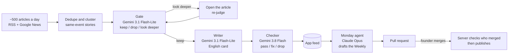

# EuropeAI Radar: building a trustworthy AI news product for under CHF 5 a month

**EuropeAI Radar** is an iOS app that follows AI across Europe: it reads the press of about 35
countries in their own languages every day, keeps the stories that are really about AI in Europe,
and shows each one as a short English card linked to its sources. Every Monday it adds a strategic
read, the *Weekly Europe Stand*, and an *Events* tab lists in-person AI events in 22 cities.

[App Store](https://apps.apple.com/app/id6783374358) · [europeairadar.com](https://europeairadar.com)

I am the founder and product lead. I built it with AI coding agents (Claude Code): I owned the
product, the specs, the evaluation and every decision; the agents wrote most of the code. This
repository tells the story of the product and its AI system. The app's own code is private.

---

## The problem

Europe's AI progress is spread across dozens of countries and languages, so it gets lost next to
US and Chinese news. A useful European AI feed has to read local press in local languages, decide
what really concerns Europe, and summarise it faithfully. That is three hard problems for an AI
system at once: **relevance, accuracy and cost.**

## The numbers

| | |
|---|---|
| Live on the App Store | since July 2026 |
| Sources | 8 pan-European outlets, 30 national outlets in 17 countries, Google News searches in 27 countries' own languages |
| Stories read per day | about 500 |
| Share of shown stories that pass the editorial bar | **39% → about 90%** (see Evaluation) |
| Running cost of all AI | **under CHF 5 a month** (hard cap set in Google AI Studio) |
| Human approval | every Weekly and every events update |

## Architecture

**Stack:** Expo / React Native (iOS) · FastAPI + SQLite on a small VPS · Gemini via REST ·
Claude scheduled cloud agents · GitHub Actions.

## 1. From one overloaded prompt to three single-job steps

The first version asked one model, in one call, to do six jobs for 30 stories at once: decide if
each story was AI, decide if it was European, summarise it, categorise it, tag countries and rate
importance. Every mistake added a new rule, and the prompt grew to about 1,500 words. The model
started losing the most important rule.

**The test:** I asked the *same* cheap model one focused question about 36 stories the app had
shown as "global news affecting Europe". On its own it dropped 31 of them. The model was not too
weak; the job was too crowded.

**The redesign**, one job per step:

- **Gate** reads every new story and answers one question: AI news that concerns Europe, yes or no,
  or "look deeper". It sees about 50 headlines per call, so it is cheap enough to read *all*
  stories. Before, about 120 stories a day expired without ever being read.
- **Look deeper**: stories the Gate cannot judge from a headline get their article opened, and the
  Gate decides again.
- **Writer** turns each kept story into a card. Its accuracy rules come from months of real
  mistakes: no facts the source does not state, the outlet's country is not the story's country,
  "plans" and "may" stay uncertain.
- **Checker** runs on a stronger model and compares every card with its source. It can pass,
  fix (only by removing or correcting, never adding) or drop. **The writer is never its own
  reviewer.**
- Gate and Checker share one written rule set, so they can never disagree about what belongs.

Each step has a short goal and hand-picked examples instead of a long rule list.

## 2. Evaluation before changes

Nothing changes in the app without a score.

- **Test set:** 200 stories sampled from what the app showed, dropped, held back and never read,
  in more than 20 languages, labelled *keep*, *drop* or *look deeper*. Labels were made blind to
  what the app had decided.
- **Editorial rules from the founder:** I decided 32 hard cases myself (Is a European minister's
  opinion news? A national survey with no country named? A local AI meetup?). Those decisions
  became six written rules, and the rest of the set was labelled by them.
- **Examples are never taken from the test set**, so the score is not flattered.

| Version | Precision (kept stories that are right) | Recall (right stories that were kept) |
|---|---|---|
| Old single prompt | 39% | 53% |
| Gate, Gemini 3.1 Flash-Lite | ~77% | ~81% |
| Gate, Gemini 3.8 Flash | ~90% | ~73% |
| Gate + Checker (estimate) | ~88–91% | ~70–76% |

*Honest note:* the rules were tuned after seeing these results, so these are development scores.
A fresh held-out set gives the final number.

**Rollout:** the new steps first ran in *shadow mode* next to the old job, writing only a log,
before they replaced it.

## 3. Cost as a design constraint

- Model per job: the cheap model filters and writes; the strong model only checks.
- **Thinking tokens are billed as output.** The Checker with full thinking used ~11,500 thinking
  tokens per 20 cards, about $10 a month alone. With low thinking it reached the same verdict on
  37 of 40 test cards at about a fifth of the cost.
- A monthly spend cap and budget alerts in Google AI Studio, plus a daily call limit in code.

## 4. Agents that draft, a human who decides

Two scheduled cloud agents (Claude Opus) run every Monday:

- **The Weekly:** reads the week's stories from the app's own API, opens the original articles to
  check key facts (the first run checked 30 and dropped 5 it could not confirm), writes the
  analysis and opens a pull request with a health report of the news pipeline.
- **Events:** searches 22 cities for AI events and keeps one only if **its own page states the
  date and the city**. The first run found 36 events; a spot check matched 8 of 8 to their pages.

**Merging the pull request is the approval.** A detail worth sharing: the cloud agent acts on
GitHub *under the owner's name* ("via the Claude app"). So "merged by the founder" alone could be
the agent itself. Before publishing, the server checks with the GitHub API that the merge event
has **no app attached**, and that the pull request changed nothing outside the content folder.
If no draft arrives by Monday noon, a GitHub Action opens an issue to alert me.

## What I learned

- **Split the job before you upgrade the model.** The same cheap model got it right with one job.
- **Measure first.** A 200-story test set turned "the feed feels noisy" into 39% and a target.
- **Write the editorial rules down.** The hardest part was deciding what counts, not the code.
- **Read the terms.** Google's terms allow only paid API use for apps used in the EEA, Switzerland
  and the UK, and forbid using search-grounding links to find pages to crawl. Both changed the design.
- **Design the approval, not just the automation.** The AI drafts; a person publishes; the system
  proves which one did what.

---

*Founder and product lead: Daniela Muc. Built with Claude Code.*
